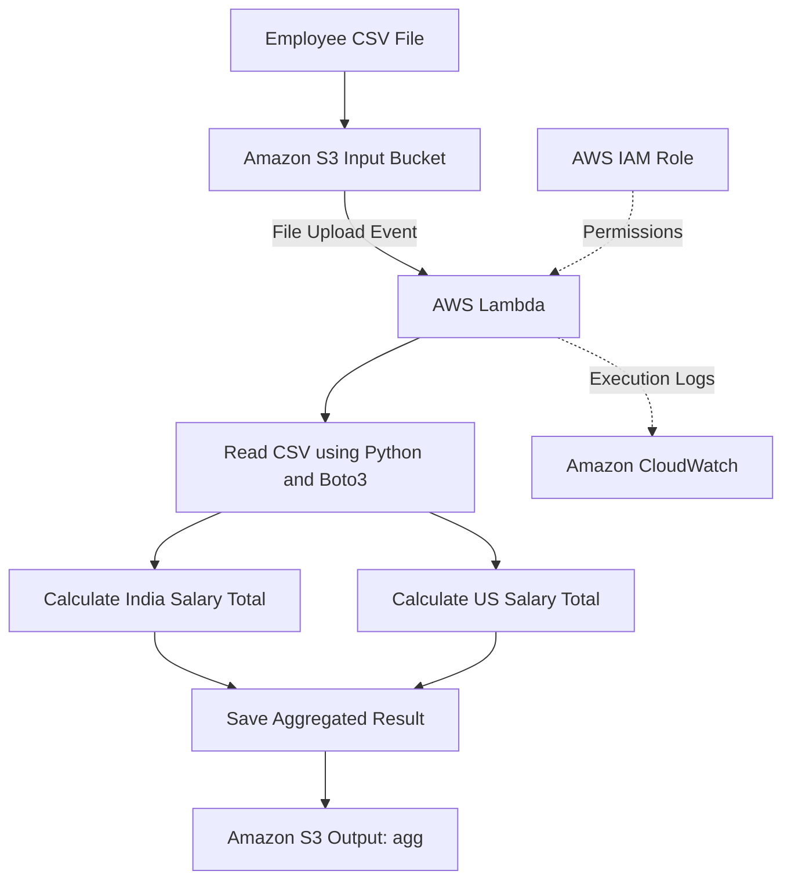

# AWS Serverless Salary Analytics Pipeline

## Project Overview

SalaryStream is a serverless data processing project built using Python and AWS services. It automatically processes employee salary data whenever a CSV file is uploaded to Amazon S3.

The AWS Lambda function reads the employee data, calculates the total salary for employees in India and the US, and stores the result in S3 as `agg`.

## Architecture



## AWS Services Used

- **Amazon S3:** Stores input CSV files and the output.
- **AWS Lambda:** Automatically processes uploaded files.
- **AWS IAM:** Manages permissions for the Lambda function.
- **Amazon CloudWatch:** Stores Lambda execution logs.

## How It Works

1. Upload an employee CSV file to the S3 bucket.
2. S3 triggers the Lambda function.
3. Lambda reads the CSV file using Python and Boto3.
4. The function separates employee salaries by location.
5. It calculates the total salary for India and the US.
6. The result is saved in S3 as `agg`.
7. CloudWatch logs help monitor the execution.

## Input Data

The input is an employee CSV file containing salary and location information.

## Output

The Lambda function writes the calculated salary totals to an S3 object named `agg`.

Example output format:

```text
total india,us salary spend is ,(120000, 130000)
```

*Note: The values above are illustrative. Actual totals depend on the input CSV file.*

## Technologies Used

- Python
- Boto3
- Amazon S3
- AWS Lambda
- AWS IAM
- Amazon CloudWatch

## Key Learnings

- Event-driven serverless architecture
- CSV data processing using Python
- S3 and Lambda integration
- AWS permissions using IAM
- Monitoring executions using CloudWatch

## Author

MCA Student | Aspiring Data Engineer
